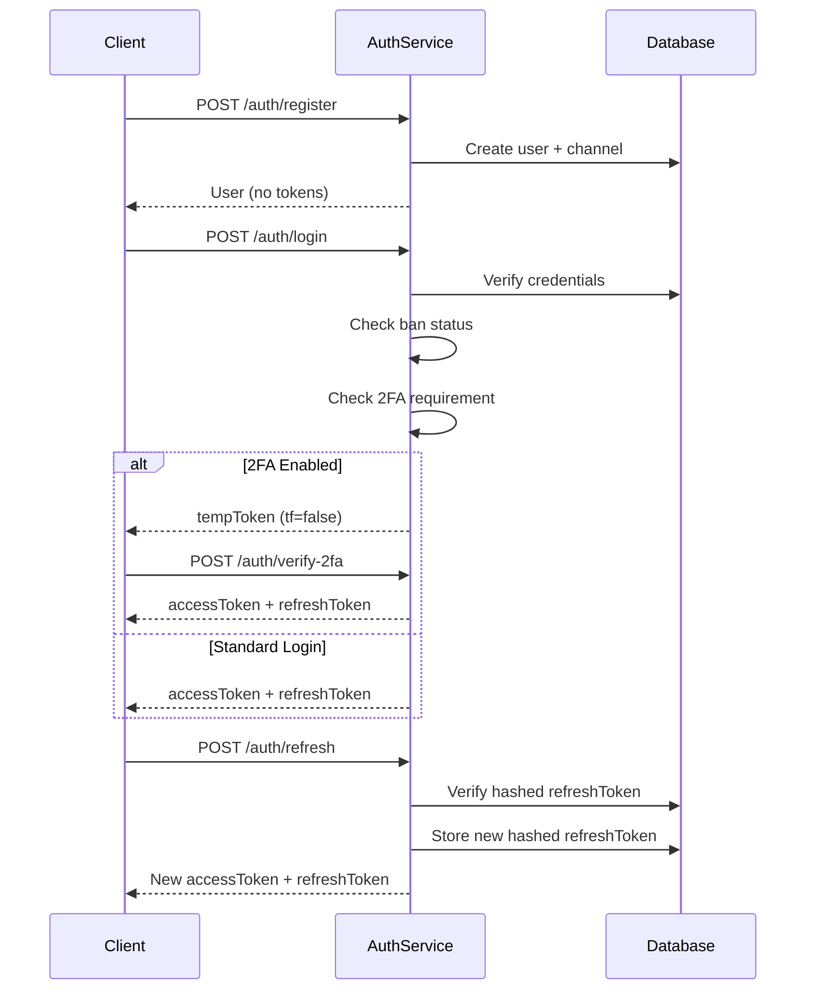
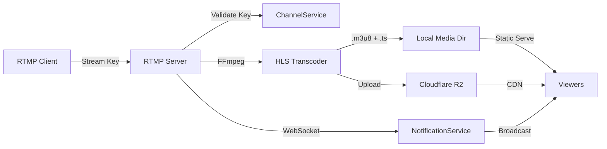

# Rappio Server — Architecture Overview

## Tech Stack

| Layer          | Technology                   |
|----------------|------------------------------|
| Runtime        | Node.js + NestJS             |
| Language       | TypeScript                   |
| Database       | PostgreSQL via Prisma ORM    |
| Auth           | JWT + Passport + Google OAuth|
| Storage        | Cloudflare R2 (S3-compatible)|
| Real-time      | Socket.IO (WebSocket)        |
| Queue          | Bull (Redis-backed)          |
| Email          | SMTP via `@nestjs-modules/mailer` |
| Video          | FFmpeg (HLS transcoding)     |
| Rate Limiting  | `@nestjs/throttler`          |

---

## Module Map

```
src/
├── common/                  # Shared utilities
│   ├── dto/                 # Shared DTOs
│   ├── filters/             # Global exception filter
│   ├── guards/              # Global guards (Terms, Ban, Throttle)
│   ├── helpers/             # Shared helper functions
│   │   ├── ban-check.helper.ts
│   │   ├── shadow-ban-filter.helper.ts
│   │   ├── stream-key.helper.ts
│   │   ├── token.helper.ts
│   │   └── user-sanitizer.helper.ts
│   ├── jwt.constants.ts
│   └── video.constants.ts
├── config/
│   └── mail.config.ts       # SMTP configuration factory
├── module/
│   ├── auth/                # Authentication & authorization
│   ├── user/                # User profile management
│   ├── channel/             # Channel CRUD, stream keys, recommendations
│   ├── content/             # VOD & live stream content management
│   ├── video/               # Video processing, FFmpeg, R2 uploads
│   ├── chat/                # Live chat rooms & messages
│   ├── follow/              # Channel follow/unfollow
│   ├── moderator/           # Channel moderation, bans, appeals
│   ├── notification/        # Push & in-app notifications
│   ├── r2-worker/           # R2 multipart upload API
│   ├── streams/             # Stream management (stub)
│   ├── cloudflare/          # Cloudflare integration
│   ├── live-comment/        # Live stream comments
│   ├── mail/                # Email sending service
│   ├── admin-dashboard/     # Admin panel endpoints
│   ├── watch-history/       # View tracking & watch history
│   └── user-notification-preference/
├── prisma/                  # Prisma schema & service
├── seeder/                  # Database seeding
├── swagger/                 # Swagger/OpenAPI setup
└── utils/                   # Standalone utility functions
```

---

## Authentication Flow



---

## Live Streaming Pipeline



---

## Database Overview

The Prisma schema defines the following core models:

| Model       | Purpose                                |
|-------------|----------------------------------------|
| `User`      | User accounts, auth, profile, bans     |
| `Channel`   | Creator channels with stream keys      |
| `Content`   | VODs, live streams, metadata           |
| `ChatRoom`  | Per-channel chat rooms                 |
| `ChatMessage` | Individual chat messages             |
| `Follow`    | User→Channel follow relationships      |
| `Moderator` | Channel moderator assignments          |
| `BanUser`   | Channel-level user bans                |
| `Notification` | User notifications                  |
| `WatchHistory` | View tracking with deduplication    |
| `AuthLog`   | Login attempt tracking (security)      |

---

## Shared Helpers

| Helper                        | Purpose                                          | Replaces                                    |
|-------------------------------|--------------------------------------------------|---------------------------------------------|
| `user-sanitizer.helper.ts`   | Strips sensitive fields from user objects         | 5+ manual destructure patterns in auth      |
| `token.helper.ts`            | JWT access/refresh/temp token generation          | 4 duplicated sign() blocks in auth          |
| `ban-check.helper.ts`        | Ban validation + auto-unban for temp bans         | 3 identical ban blocks in auth              |
| `stream-key.helper.ts`       | Generates 64-char hex stream keys                 | Duplicate method in auth + channel          |
| `shadow-ban-filter.helper.ts`| Prisma where-clause for shadow-ban visibility     | 5 duplicated filter blocks in content       |

---

## Global Guards

Applied via `APP_GUARD` in `AppModule`:

1. **TermsAcceptedGuard** — Ensures users have accepted Terms of Service
2. **BanGuard** — Blocks banned users from accessing the API
3. **ThrottlerGuard** — Rate limits all endpoints (1000 req/min default)

---

## Configuration

| Variable         | Description                          | Default          |
|------------------|--------------------------------------|------------------|
| `JWT_SECRET`     | JWT signing secret                   | Required         |
| `JWT_EXPIRES_IN` | Access token TTL                     | `30d`            |
| `JWT_REFRESH_SECRET` | Refresh token secret             | Falls back to JWT_SECRET |
| `JWT_REFRESH_EXPIRES_IN` | Refresh token TTL            | `7d`             |
| `SALT_ROUND`     | bcrypt salt rounds                   | Required         |
| `CORS_ORIGINS`   | Comma-separated allowed origins      | localhost + rappio domains |
| `SMTP_HOST`      | SMTP server                          | Required         |
| `SMTP_PORT`      | SMTP port                            | `587`            |
| `SMTP_USER`      | SMTP username                        | Required         |
| `SMTP_PASS`      | SMTP password                        | Required         |
| `R2_ACCOUNT_ID`  | Cloudflare R2 account                | Required         |
| `R2_BUCKET`      | R2 bucket name                       | Required         |
| `DATABASE_URL`   | PostgreSQL connection string         | Required         |
| `GOOGLE_CLIENT_ID` | Google OAuth client ID             | Required         |
