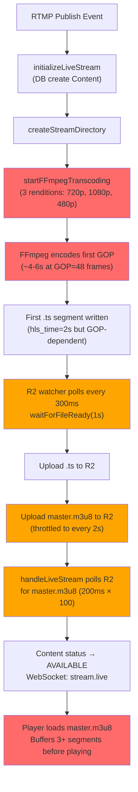
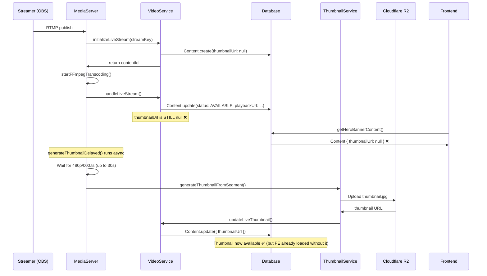

# Streaming Latency & Missing Thumbnail — Root Cause Analysis & Fix Plan

## Issue 1: Streaming Start Time > 1 Minute

### Root Cause Analysis

The live streaming pipeline has a **cascading sequence of delays** that compound to over 1 minute before a viewer can watch:

#### Bottleneck Breakdown

| Step | Delay | Location |
|------|-------|----------|
| **FFmpeg startup & first GOP** | ~6-10s | [media-server.service.ts:313-431](file:///Users/arafatmannan/Desktop/Arafat/office/rappio-server/src/module/video/media-server.service.ts#L313-L431) — Runs `libx264` with `veryfast` preset for **3 parallel renditions** (720p, 1080p, 480p). Each needs a full GOP (48 frames @ 24fps = 2s, or 48 frames @ 30fps = 1.6s) before the first segment is written |
| **HLS segment ready** | ~2-4s | `hls_time=2` requires 2s of encoded content per segment, but real-world write can take longer due to codec buffering |
| **R2 watcher poll + upload** | ~2-5s | [r2-upload.service.ts:117-233](file:///Users/arafatmannan/Desktop/Arafat/office/rappio-server/src/module/video/r2-upload.service.ts#L117-L233) — polls every 300ms, calls [waitForFileReady(1s)](file:///Users/arafatmannan/Desktop/Arafat/office/rappio-server/src/module/video/r2-upload.service.ts#243-273), then uploads each [.ts](file:///Users/arafatmannan/Desktop/Arafat/office/rappio-server/src/main.ts) segment sequentially |
| **Playlist throttle** | ~2s | Playlist uploads [throttled to every 2s](file:///Users/arafatmannan/Desktop/Arafat/office/rappio-server/src/module/video/r2-upload.service.ts#L202) |
| **Manifest polling on R2** | ~0.2-20s | [video.service.ts:579-595](file:///Users/arafatmannan/Desktop/Arafat/office/rappio-server/src/module/video/video.service.ts#L579-L595) — polls R2 every 200ms, up to 100 attempts (20s timeout) |
| **`hls_playlist_type event`** | **critical** | [media-server.service.ts:383](file:///Users/arafatmannan/Desktop/Arafat/office/rappio-server/src/module/video/media-server.service.ts#L382-L383) — `event` type tells the player this is a growing playlist. Many players wait for **3+ segments** before starting playback (~6s minimum of encoding time) |
| **`hls_list_size 10`** | minor | Keeps 10 segments in the playlist, but combined with `event` type, this is contradictory |
| **Player initial buffering** | ~5-15s | After getting the playlist, the player buffers multiple segments before starting playback |

> [!CAUTION]
> **The combination of `hls_playlist_type event` + `delete_segments` in hls_flags is contradictory.** `event` type means segments should never be deleted from the playlist, but `delete_segments` removes old ones. This can confuse players and cause excessive buffering or errors.

**Total estimated latency: 20-60+ seconds**

---

## Issue 2: Thumbnails Missing from Home Page Hero Banner

### Root Cause Analysis

The thumbnail for live streams is generated **asynchronously after** the stream starts, but the Content record is created **without any thumbnailUrl**:

#### Key Problems

1. **Race condition**: Content is created and marked `AVAILABLE` *before* thumbnail generation completes. The hero banner API may return content with `thumbnailUrl: null`.

2. **Async fire-and-forget**: In [media-server.service.ts:236](file:///Users/arafatmannan/Desktop/Arafat/office/rappio-server/src/module/video/media-server.service.ts#L236), [generateThumbnailDelayed()](file:///Users/arafatmannan/Desktop/Arafat/office/rappio-server/src/module/video/media-server.service.ts#248-294) is called without `await` — it's fire-and-forget. If it fails silently, the thumbnail is never set.

3. **Segment dependency**: The thumbnail waits for `480p/000.ts` which is the **third rendition** in the FFmpeg output. The rendition order in `VIDEO_RENDITIONS` is [720p, 1080p, 480p], so 480p segments are generated last.

4. **Segment deletion conflict**: The R2 watcher in [r2-upload.service.ts:177-181](file:///Users/arafatmannan/Desktop/Arafat/office/rappio-server/src/module/video/r2-upload.service.ts#L177-L181) preserves `000.ts` for thumbnail generation, but only for the upload cycle. The segment could be deleted by FFmpeg's `delete_segments` flag before the thumbnail service reads it.

5. **Bug in [captureThumbnailFromFile](file:///Users/arafatmannan/Desktop/Arafat/office/rappio-server/src/module/video/thumbnail.service.ts#209-262)**: [thumbnail.service.ts:238](file:///Users/arafatmannan/Desktop/Arafat/office/rappio-server/src/module/video/thumbnail.service.ts#L238) logs `errorOutput` **before** FFmpeg has had a chance to write to it (the log is outside the event handlers, executed synchronously while FFmpeg is still starting). This masks actual errors.

---

## Proposed Changes

### Component 1: FFmpeg Transcoding (Latency Fix)

#### [MODIFY] [media-server.service.ts](file:///Users/arafatmannan/Desktop/Arafat/office/rappio-server/src/module/video/media-server.service.ts)

1. **Change `hls_playlist_type` from `event` to removing it entirely** (default is [live](file:///Users/arafatmannan/Desktop/Arafat/office/rappio-server/src/module/content/content.service.ts#291-378) type for live streaming)
2. **Remove contradictory `delete_segments` flag** — use just `independent_segments+program_date_time+append_list`
3. **Reduce HLS segment time** from `2` to `1` second for faster first-segment availability
4. **Add FFmpeg low-latency flags**: `-fflags nobuffer -flags low_delay -analyzeduration 500000 -probesize 500000` for faster input analysis
5. **Consider reducing to 2 renditions** initially (720p + 480p) instead of 3, removing 1080p from the live path to halve encoding time

---

### Component 2: R2 Upload Watcher (Latency Fix)

#### [MODIFY] [r2-upload.service.ts](file:///Users/arafatmannan/Desktop/Arafat/office/rappio-server/src/module/video/r2-upload.service.ts)

1. **Upload the master playlist immediately** upon first detection, without the 2-second throttle for the initial upload
2. **Reduce [waitForFileReady](file:///Users/arafatmannan/Desktop/Arafat/office/rappio-server/src/module/video/r2-upload.service.ts#243-273) timeout** from `1000ms` to `500ms`

---

### Component 3: Manifest Polling (Latency Fix)

#### [MODIFY] [video.service.ts](file:///Users/arafatmannan/Desktop/Arafat/office/rappio-server/src/module/video/video.service.ts)

1. **Still poll for manifest** but set a faster poll interval (100ms instead of 200ms) and reduce max attempts

---

### Component 4: Thumbnail Generation (Thumbnail Fix)

#### [MODIFY] [media-server.service.ts](file:///Users/arafatmannan/Desktop/Arafat/office/rappio-server/src/module/video/media-server.service.ts)

1. **Change thumbnail source** from `480p/000.ts` (last rendition) to `720p/000.ts` (first rendition) — this segment is available sooner
2. **Generate thumbnail from RTMP stream directly** as a fallback if segment-based approach is slow

#### [MODIFY] [thumbnail.service.ts](file:///Users/arafatmannan/Desktop/Arafat/office/rappio-server/src/module/video/thumbnail.service.ts)

1. **Fix the premature error logging bug** at line 238 — move the `this.logger.error()` call inside the `ffmpeg.on('close')` handler
2. **Add error handler** on FFmpeg spawn for the [captureThumbnailFromFile](file:///Users/arafatmannan/Desktop/Arafat/office/rappio-server/src/module/video/thumbnail.service.ts#209-262) method

#### [MODIFY] [video.service.ts](file:///Users/arafatmannan/Desktop/Arafat/office/rappio-server/src/module/video/video.service.ts)

1. **No structural changes needed** — the [updateLiveThumbnail](file:///Users/arafatmannan/Desktop/Arafat/office/rappio-server/src/module/video/video.service.ts#782-823) method correctly updates the DB

---

### Component 5: Content Creation (Thumbnail Fix)

#### [MODIFY] [media-server.service.ts](file:///Users/arafatmannan/Desktop/Arafat/office/rappio-server/src/module/video/media-server.service.ts)

1. **Await thumbnail before marking stream as fully ready** — or at minimum, generate a placeholder thumbnail frame from the RTMP input during [handleStreamStart](file:///Users/arafatmannan/Desktop/Arafat/office/rappio-server/src/module/video/media-server.service.ts#165-247) *before* calling [handleLiveStream](file:///Users/arafatmannan/Desktop/Arafat/office/rappio-server/src/module/video/video.service.ts#553-652)

---

## User Review Required

> [!IMPORTANT]
> **Rendition count trade-off**: Dropping 1080p from live streaming would nearly halve FFmpeg startup time and CPU usage, but viewers on high-bandwidth connections would be limited to 720p max during live. The 1080p rendition could still be used for VOD processing. **Do you want to keep 1080p for live, or drop it?**

> [!WARNING]
> **HLS segment duration**: Reducing from 2s to 1s segments means more R2 upload operations (2× more files), which increases R2 API costs and bandwidth. **Are you okay with this trade-off?**

> [!IMPORTANT]
> **Thumbnail timing strategy**: There are two options:
> 1. **Option A (Recommended)**: Generate thumbnail from the RTMP stream directly (captures a frame early, ~8s into the stream) and update DB *before* marking content as AVAILABLE. This ensures the thumbnail is always present when the hero banner loads.
> 2. **Option B**: Keep the current async approach but change the source segment from `480p/000.ts` to `720p/000.ts` for faster availability. The thumbnail may still be missing briefly on first load.
> 
> **Which approach do you prefer?**

## Verification Plan

### Manual Verification
Since there are no existing tests, I'd recommend the user verify by:
1. Start a live stream via OBS/streaming software
2. Time how long until the stream is playable on the frontend
3. Check if the thumbnail appears in the hero banner immediately after the stream goes live
4. Monitor the server logs for any FFmpeg or thumbnail generation errors

I'd appreciate your **guidance on the best way to test streaming** in your environment, since these changes affect real-time media processing.
